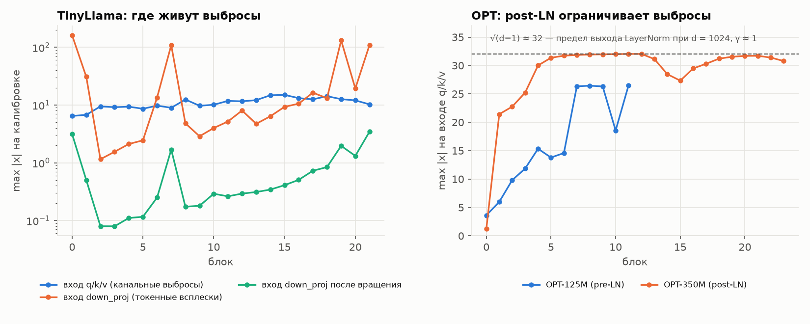
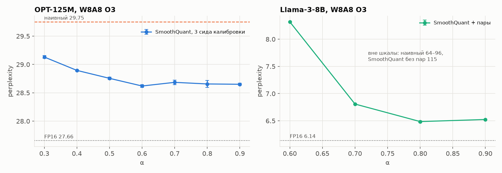
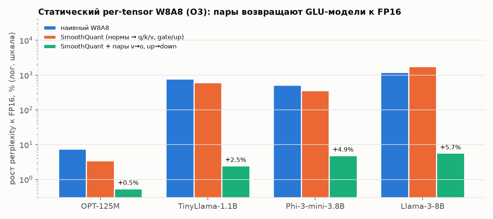
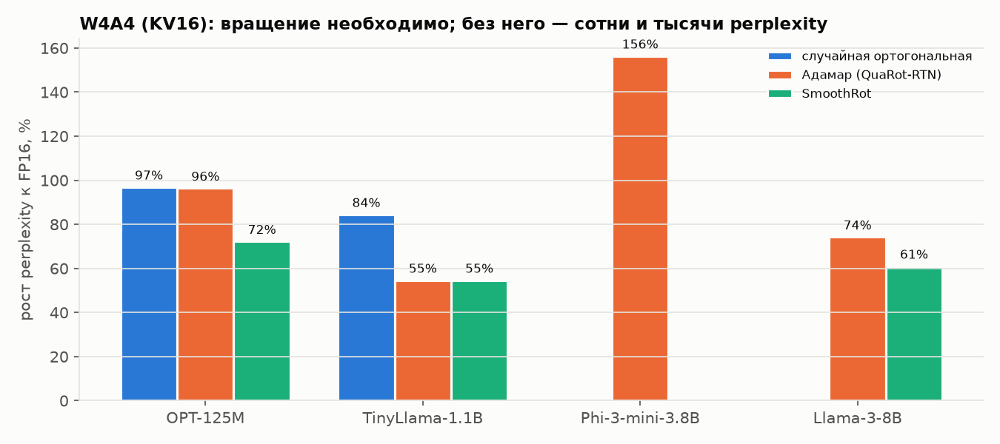
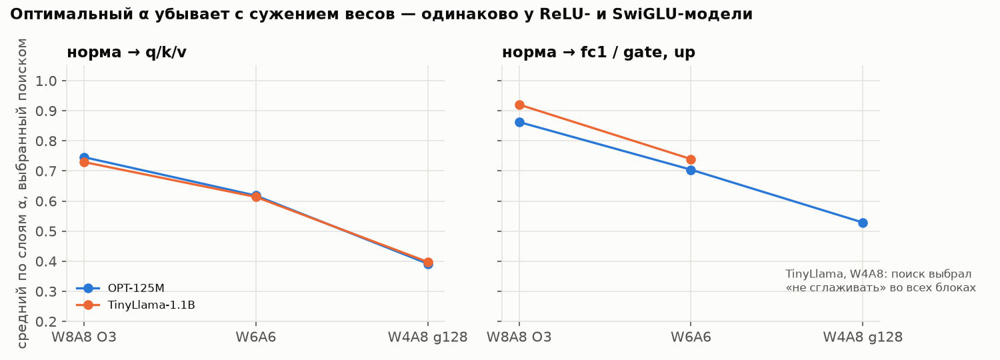

# Борьба с выбросами в активациях при квантовании LLM

Продолжение работы по 4-битному квантованию весов (README.md): квантование **активаций** (W8A8, W6A6,
W4A8, W4A4) и методы борьбы с выбросами в них. Воспроизведены SmoothQuant (Xiao et al., ICML 2023),
LLM.int8() (Dettmers et al., NeurIPS 2022) и QuaRot (Ashkboos et al., NeurIPS 2024); изучен официальный код
SmoothQuant и QuaRot; предложены и проверены собственные модификации. Протокол perplexity тот же, что в
основной части работы, поэтому все числа сопоставимы с `results/summary.csv`.

Измерено около 315 конфигураций на шести моделях от 125M до 8B параметров (три семейства GLU-моделей);
Phi-3-mini и Llama-3-8B оцениваются послойно.

## Главное

- **Выбросы бывают двух видов, и это определяет метод.** Канальные (одни и те же измерения на всех токенах:
  входы q/k/v, fc1) лечатся сглаживанием и вращением. Токенные (отдельные токены — первый, «\n», «.» — на
  входе down_proj у GLU-моделей, max|x| до 161 при медиане ~0.1) не лечатся ни SmoothQuant, ни вращением.
- **SmoothQuant воспроизведён**: на OPT-125M он убирает больше половины потерь W8A8 в per-tensor режимах;
  на Llama-3-8B, как и в статье CushionCache, в статическом per-tensor режиме он не помогает (115 против
  наивных 64–96).
- **QuaRot воспроизведён с точностью 0.9 %**: QuaRot-RTN W4A4 на Llama-3-8B — 10.69 против 10.60 в литературе.
  Без вращения W4A4 разрушает все модели (perplexity в сотни и тысячи).
- **Выбор точки сглаживания важнее выбора α.** Отказ SmoothQuant в статическом per-tensor W8A8 на GLU-моделях
  устраняет одна точка — пара up→down: она убирает 98–99 % потерь на всех четырёх GLU-моделях (TinyLlama,
  Qwen2.5-1.5B, Phi-3-mini, Llama-3-8B), а пара v→o не помогает ни на одной. Со сглаживанием норм и обеих
  пар: TinyLlama 67.3 → 7.90, Qwen2.5 96.2 → 9.86, Phi-3 37.1 → 6.30, Llama-3-8B 115 → 6.49
  (+2.5…+6.5 % к FP16; разброс по трём сидам калибровки не больше 0.017 на всех четырёх моделях). На Llama-3-8B это не хуже метода CushionCache (7.37–7.41 за 15.8 ч на четырёх A6000)
  и при калибровке с BOS (7.31), и с весами группами (6.42).
- **Форма масштаба: квантильный пол s ← max(s, Q_p(s))** — одно правило вместо эвристики: исправляет найденный
  численный отказ сглаживания пар на ReLU-моделях (OPT-125M: 6972 → 27.80; OPT-350M: 1878 → 22.37, переполнение
  FP16 → 22.37) и уменьшает порчу узких весов
  (TinyLlama W4A8: 9.48 → 8.34 при α 0.85; лучший результат 8.33 против 8.63 у лучшего глобального α). При
  W8A8 и W6A6 пол не помогает. Устойчивая статистика (среднее поканальных максимумов) хуже максимума везде.
- **Оптимальный α SmoothQuant систематически убывает с сужением весов** (W8A8 0.75 → W6A6 0.6 → W4A8 0.4 для
  входов q/k/v), одинаково на ReLU- и SwiGLU-модели. Послойный поиск α находит лучший глобальный α сам, но
  почти не превосходит его.
- **В официальном коде QuaRot для OPT найдены две ошибки, ломающие функцию модели при вращении** (по чтению
  кода), и причина расхождения нашего воспроизведения (сетка отсечения весов).

## Окружение и модели

То же, что в основной части: RTX 4060 Laptop 8 ГБ, WSL2, Python 3.12, torch 2.14.1, transformers 5.21.0.
Модели: OPT-125M, OPT-350M, TinyLlama-1.1B, Qwen2.5-1.5B, Phi-3-mini-4k-instruct (3.8B, послойно),
Llama-3-8B (послойно).

## Что добавлено

```
outliers/
├── quant.py          # fake-quant активаций (per-token / per-tensor дин. / per-tensor стат.) и весов;
│                     #   QLinear (онлайн-Адамар, квантование входа и выхода); режим LLM.int8()
├── hadamard.py       # Адамар нужных порядков: Сильвестр × Пэли (768, 3072, 5632, 14336, ...)
├── arch.py           # описание блоков OPT (pre/post-LN), Llama-подобных (GQA), Phi-3 (слитые проекции)
├── smooth.py         # SmoothQuant: нормы → линейные + пары v→o, fc1→fc2, up→down; нижняя граница масштаба
├── rotate.py         # QuaRot: центрирование, LN → RMSNorm, слияние γ/β, вращение Q, онлайн-Адамар
├── alpha_search.py   # послойный поиск α по сетке (mse / без позиции 0 / потокенно-относительная потеря)
├── calib.py          # калибровка, статистики выбросов, захват входов
├── pipeline.py       # порядок шагов для полной модели
├── layerwise_api.py  # те же преобразования для одного блока
├── layerwise_eval.py # послойная оценка с калибровкой и вращением (на основе evaluation/layerwise.py)
└── ppl.py            # копия протокола perplexity
run_actquant.py        # прогон на полной модели  -> results/actquant.csv
run_large_actquant.py  # прогон послойно (Phi-3, Llama-3-8B) -> results/actquant_large.csv
collect_act_stats.py   # статистики входов Linear по слоям -> results/act_stats/
make_outlier_report.py # графики этого отчёта
test_outliers.py       # 56 проверок на крошечных моделях из конфигов (CPU, без скачивания)
verify_math.py         # numpy-проверка алгебры всех преобразований
```

Существующий код (`evaluation/`, `quantizers/`, `run_large.py`) не менялся; послойная оценка использует
функции `evaluation/layerwise.py` без изменений.

## Методика

**Что квантуется.** Входы всех `nn.Linear` внутри трансформерных блоков (и их веса). Эмбеддинги, `lm_head`,
нормализации остаются в FP16. Входы BMM внимания и KV-кэш по умолчанию не квантуются (флаг `--quant-bmm`
включает квантование выходов q/k/v, как в официальном SmoothQuant). Fake-quant: значения квантуются и сразу
деквантуются в FP16; скорость не измеряется.

**Режимы активаций** (обозначения SmoothQuant): **O1** — per-token динамическая шкала; **O2** — per-tensor
динамическая (одна шкала на окно 2048); **O3** — per-tensor статическая (шкала заранее по калибровке).
Квантование симметричное, `scale = max|x| / (2^(b−1)−1)`.

**Веса.** W8 и W6 — per-channel симметрично; W4A8 — группами по 128; W4A4 — per-channel симметрично с поиском
отсечения по ||w − q(w)||^2.4 (80 значений 1.00…0.21, как в QuaRot), активации с отсечением 0.9 (рецепт
QuaRot-RTN).

**Калибровка.** 128 случайных отрезков по 512 токенов из WikiText-2 **train** без BOS (окна оценки, кроме
первого, тоже начинаются с середины текста). Для статических режимов — три сида калибровки.

**Послойная оценка** (Phi-3, Llama-3-8B): калибровочный буфер идёт через неквантованные блоки, по нему на
каждом блоке собираются max|X_j|; для вращения буфер окон поворачивается на входе блока 0 и возвращается
перед финальной нормой. Пик видеопамяти 4.5–5.1 ГБ, одна конфигурация Llama-3-8B — 7–15 минут.

## Проверка корректности

- `test_outliers.py`: инвариантность сглаживания и вращения на OPT (pre-/post-LN), Llama с GQA и Phi-3
  (относительная разница логитов < 10⁻⁶), совпадение послойной схемы с полной, свойства квантователей,
  форма захваченных входов. `verify_math.py`: та же алгебра в numpy.
- Вычислительная инвариантность вращения на настоящих весах при 16 битах: OPT-125M 27.6549 (FP16 27.656),
  TinyLlama 7.7076 (7.7077).
- Послойная оценка против полной на TinyLlama: FP16 7.7077 = 7.7077; вращение 7.7076 = 7.7076; SmoothQuant
  O3 7.8969 ≈ 7.8972; QuaRot-RTN W4A4 11.9847 ≈ 11.9846.
- Квантователь весов совпадает с прежним RTN: W4 g128 sym/asym на TinyLlama 9.524 / 8.503 (README: 9.524 / 8.502).

## Результаты

### 1. Где живут выбросы



| Модель | Входы q/k/v, fc1 / gate, up | Вход out_proj / o_proj | Вход fc2 / down_proj |
|---|---|---|---|
| OPT-125M | канальные: max\|x\| до 26, max/median по каналам 9–28, одни и те же измерения (422, 20, 355) в блоках 2–11 | чисто (max ≤ 2.4) | токенные на позиции 0 в блоках 0–4 (эксцесс до 76 тыс.) |
| OPT-350M (post-LN) | упираются ровно в 32.0 = √(d−1): выход LayerNorm ограничен; max/median ≈ 8.5 | чисто | умеренно (max ≤ 30 в блоке 1) |
| TinyLlama | канальные: max ≤ 15, max/median по токенам ≈ 1.7 | чисто | **токенные всплески** в блоках 0, 1, 6, 7, 19, 21: max 109–161, эксцесс до 2·10⁶, max/median по токенам до 1224 |

- У OPT самый «громкий» токен с блока 4 **всегда на позиции 0** — даже без BOS: это эффект позиции
  (attention sink), а не конкретного токена.
- У TinyLlama всплески блоков 0, 19, 21 — на токенах «\n» и «.», а блоков 1, 6, 7 — на позиции 0, но только
  без BOS: с BOS всплеск в блоке 7 падает со 109 до 8.6.
- **После вращения** входы q/k/v почти гауссовы (избыточный эксцесс 0.0, max ≈ 6), но токенный всплеск
  down_proj блока 0 ослаб лишь в 8.6 раза (max/median 1224 → 143) — как у PrefixQuant (4161 → 461).
- Методическое следствие: калибровка официального SmoothQuant (BOS в начале каждого отрезка) недооценила бы
  статическую шкалу входа down_proj блока 7 TinyLlama примерно в 13 раз.

### 2. LLM.int8()

| Модель | FP16 | Векторный INT8 | LLM.int8() (порог 6) | Выбросных измерений, макс. по слою |
|---|---|---|---|---|
| OPT-125M | 27.656 | 27.942 (+1.0 %) | 27.692 (+0.13 %) | 12 |
| OPT-350M | 22.002 | 22.074 (+0.33 %) | 22.005 (+0.01 %) | 25 |
| TinyLlama | 7.708 | 7.792 (+1.1 %) | 7.759 (+0.67 %) | 111 |
| Phi-3-mini | 6.008 | 6.296 (+4.8 %) | 6.058 (+0.8 %) | — |
| Llama-3-8B | 6.136 | 6.265 (+2.1 %) | 6.218 (+1.3 %) | — |

Векторный INT8 совпадает с наивным W8A8 O1 (TinyLlama 7.7920 = 7.7920). Сверка с bitsandbytes
(`run_bnb_int8.py`, порог 0 / 6): OPT-125M 27.936 / 27.717, OPT-350M 22.089 / 22.048, TinyLlama 7.791 / 7.773 —
без декомпозиции расхождение ≤ 0.015, с декомпозицией наша реализация на 0.014–0.043 лучше (вероятно, потому что
веса выбросных каналов у нас остаются в FP16). Смешанная декомпозиция с порогом 6
возвращает почти всю потерю; на Phi-3 с массивными активациями — особенно заметно (+4.8 % → +0.8 %).

### 3. W8A8: наивный против SmoothQuant

**OPT-125M** (O3 — среднее ± ст. откл. по трём сидам):

| Режим | Наивный | SmoothQuant, лучший α | + пары, граница 0.05 |
|---|---|---|---|
| O1 per-token | 27.94 (+1.0 %) | 27.68 (+0.08 %), α 0.6 | — |
| O2 per-tensor дин. | 29.48 (+6.6 %) | 28.32 (+2.4 %), α 0.9 | **27.93** (+1.0 %), α 0.6 |
| O3 per-tensor стат. | 29.75 ± 0.02 (+7.6 %) | 28.62 ± 0.02 (+3.5 %), α 0.6 | **27.81** (+0.5 %), α 0.75 |

**TinyLlama:**

| Режим | Наивный | SmoothQuant, лучший α | + пары, α 0.85 | Наивный, вход down_proj в 16 битах |
|---|---|---|---|---|
| O1 | 7.792 | 7.749 | 7.762 | — |
| O2 | 22.67 | 21.11 | **8.09** | — |
| O3 | 67.3 ± 1.0 | 55.1 ± 0.8 | **7.90 ± 0.01** | 8.20 ± 0.01 |

**OPT-350M (post-LN)**: наивный O1 / O2 / O3 = 22.06 / 22.39 / 22.45 — post-LN держит выбросы под √d, и
W8A8 почти без потерь даже наивно. Сглаживание через LayerNorm здесь невозможно (код это проверяет).



Оптимум α для OPT-125M плоский в диапазоне 0.6–0.9 и близок к значению 0.5 из статьи; разброс по сидам
(0.01–0.06) много меньше эффекта. Оригинальный SmoothQuant на TinyLlama в per-tensor режимах почти бесполезен:
катастрофу создают токенные всплески на входе down_proj, а нормы этот вход не питают.

### 4. Llama-3-8B и Phi-3-mini: сравнение с опубликованными числами

**Llama-3-8B** (FP16 6.136; в скобках — CushionCache, SmoothQuant с α 0.8):

| Метод | O1 per-token | O2 per-tensor дин. | O3 per-tensor стат. |
|---|---|---|---|
| наивный W8A8 | 6.265 (6.22) | 40.13 (23.86) | 96.11 / 64.49, сиды 0 / 1 (9759) |
| SmoothQuant, α 0.8 | 6.245 (6.19) | 42.72 (25.12) | 115.3 (14023) |
| SmoothQuant + пары, α 0.8 | 6.258 | **7.087** | **6.486 ± 0.017** (3 сида) |
| только пары, α 0.8 | — | — | 6.675 |
| протокол `ppl_eval.py` (входы BMM квантуются): наивный / SmoothQuant | 6.273 / 6.252 | — | — |

Воспроизведение CushionCache **качественное**: O1 совпадает до 0.05; в per-tensor режимах SmoothQuant, как и у
авторов, не помогает и даже немного хуже наивного. Абсолютные числа O2/O3 у нас меньше — статические шкалы
зависят от калибровки (у нас без BOS, см. раздел 1). Кривая по α для пар в O3: 0.6 → 8.32, 0.7 → 6.81,
0.8 → 6.50, 0.9 → 6.52. Основной вклад дают именно пары: без сглаживания норм — 6.67, с ним — 6.49.

**Phi-3-mini** (FP16 6.008): наивный O1 6.296; O3: наивный 37.10, SmoothQuant α 0.8 27.73, **+ пары 6.304**;
O2 + пары 6.553.



| Модель | FP16 | Наивный O3 | SmoothQuant | + пары v→o, up→down |
|---|---|---|---|---|
| OPT-125M (ReLU) | 27.66 | 29.75 | 28.62 | 27.81 (граница 0.05) |
| TinyLlama-1.1B (SwiGLU) | 7.71 | 67.3 | 55.1 | 7.90 |
| Phi-3-mini-3.8B (SwiGLU) | 6.01 | 37.1 | 27.7 | 6.30 |
| Llama-3-8B (SwiGLU) | 6.14 | 64–96 | 115.3 | 6.49 ± 0.02 |

### 5. Жёсткие режимы и вращения

Активации per-token динамические (протокол QuaRot), KV и входы BMM не квантуются.

**W4A4** (сетка отсечения весов как в официальном QuaRot):

| Модель | FP16 | Наивный | Вращение, случ. ортогональная | Вращение, Адамар (QuaRot-RTN) | SmoothRot, α 0.5 |
|---|---|---|---|---|---|
| OPT-125M | 27.66 | 3780 | 54.46 | 54.31 | **47.64** |
| TinyLlama | 7.71 | 328.4 | 14.22 | **11.92** | **11.92** |
| Phi-3-mini | 6.01 | 610.1¹ | — | 15.40 | — |
| Llama-3-8B | 6.14 | 382.3¹ | — | 10.69 (литература: 10.60 при KV4) | **9.88** |
| OPT-350M (post-LN) | 22.00 | 254.8¹ | — | онлайн-Адамар: 370.2¹ | пары: 345.2¹ |

¹ С прежней, более грубой сеткой отсечения весов (11 значений 1.00…0.50).



**W8A6, W6A6, W4A8** (OPT-125M / TinyLlama):

| Метод | W8A6 | W6A6 | W4A8 g128 |
|---|---|---|---|
| наивный | 30.40 / 20.65 | 31.99 / 21.08 | 32.92 / 9.112 |
| SmoothQuant (OPT: нормы, α 0.6; TinyLlama: + пары, α 0.85) | 28.29 / 8.112 | 28.81 / 8.505 | 31.87 / 9.476 |
| вращение, Адамар | 28.05 / 7.764 | 28.53 / 7.842 | 32.76 / 9.314 |
| вращение, случ. ортогональная | 28.12 / 7.800 | 28.43 / 7.870 | 32.81 / **9.098** |
| SmoothRot, α 0.5 | **28.02** / 7.765 | **28.26** / **7.825** | 32.93 / 9.166 |

- При W4A4 вращение необходимо, сглаживания недостаточно (TinyLlama: SmoothQuant 238 против 11.9 у вращения).
- Адамар лучше случайной ортогональной матрицы при W4A4 на TinyLlama (11.92 против 14.22) — повторяет абляцию
  QuaRot; на OPT-125M с тонкой сеткой отсечения разница исчезла.
- SmoothRot улучшает QuaRot-RTN на Llama-3-8B на 7.6 % (10.69 → 9.88) и на OPT-125M на 12 %.
- При W4A8 узкое место — веса: вращение почти ничего не даёт, а SmoothQuant с высоким α вредит.
- Для OPT-350M (post-LN) ни один метод не спасает W4A4: полное вращение невозможно, а онлайн-Адамар на входах
  out_proj/fc2 даже ухудшает (гипотеза: выход ReLU разреженный и неотрицательный, после поворота плотный).

### 6. Выбор α

**Лучший глобальный α (сглаживание норм и пар):**

| Режим | OPT-125M | TinyLlama |
|---|---|---|
| W8A8 O3 | 0.75 → 27.81 (0.6 → 27.89, 0.9 → 28.05) | 0.85 → 7.90 (0.5 → 14.41) |
| W6A6 | 0.6 → 28.79 (0.85 → 29.78) | 0.7 → 8.30 (0.6 → 8.43, 0.85 → 8.51) |
| W4A8 g128 | 0.5 → 31.45 (0.35 → 31.84, 0.65 → 31.86) | 0.5 → 8.63 (0.35 → 9.23, 0.85 → 9.48) |

**Послойный поиск α по сетке 0…1 (шаг 0.05) против лучшего глобального:**

| Модель, режим | Лучший глобальный | Поиск, mse | Поиск, без позиции 0 | Поиск, потокенно-относительная |
|---|---|---|---|---|
| OPT-125M, W8A8 O3 | **27.81** | 27.85 | 27.84 | 27.98 |
| OPT-125M, W6A6 | 28.79 | 28.81 | 28.83 | **28.48** |
| OPT-125M, W4A8 | 31.45 | 31.25 | 31.48 | **31.06** |
| TinyLlama, W8A8 O3 | 7.90 | **7.855** | **7.855** | 7.867 |
| TinyLlama, W6A6 | 8.30 | 8.237² | 8.961 | 8.289 |
| TinyLlama, W4A8 | 8.63 | **8.414** | 9.082 | 9.003 |
| OPT-125M, W4A4 (пол p 0.5) | 255.2 (α 0.85) | **197.6** | — | 205.3 |
| TinyLlama, W4A4 | 179.9 (α 0.85) | **51.0** | — | 73.9 |

Все варианты поиска — с кандидатом «не сглаживать» (s = 1), кроме ²: с этим кандидатом на TinyLlama W6A6
получается 8.953 — локально выгодный отказ от сглаживания плох глобально. При W4A4 послойный поиск выигрывает у
лучшего из проверенных глобальных α заметно (TinyLlama 179.9 → 51.0), но α 0.85 — край сетки, и вращение всё
равно намного лучше (11.92). Средний α для входов q/k/v при W4A4 — 0.70 (TinyLlama) и 0.74 (OPT-125M).



### 7. Точки и форма масштабирования

**Абляция точек сглаживания, W8A8 O3** (α 0.85 для TinyLlama, 0.8 для остальных; FP16: TinyLlama 7.708,
Qwen2.5-1.5B 9.265, Phi-3 6.008, Llama-3-8B 6.136):

| Точки | TinyLlama | Qwen2.5-1.5B | Phi-3-mini | Llama-3-8B |
|---|---|---|---|---|
| наивный | 67.3 | 96.2 | 37.1 | 64–96 |
| нормы (оригинальный SmoothQuant) | 57.2 | 75.4 | 27.7 | 115.3 |
| только v→o | 66.7 | 95.4 | 34.0 | 96.6 |
| **только up→down** | **8.32** | **10.48** | **6.74** | **6.75** |
| обе пары | 8.33 | 10.45 | — | 6.68 |
| нормы + v→o | 56.4 | — | — | — |
| нормы + up→down | 7.91 | — | — | 6.58 |
| attn + up→down | 8.13 | — | — | — |
| mlp + up→down | 7.99 | — | — | — |
| нормы + обе пары | **7.90** | **9.86** | **6.30** | **6.49** |
| то же, среднее ± ст. откл. по 3 сидам калибровки | 7.904 ± 0.012 | 9.864 ± 0.004 | 6.3042 ± 0.0005 | 6.486 ± 0.017 |


- Пара up→down убирает 98–99 % потерь на всех четырёх GLU-моделях; пара v→o не даёт ничего (обе пары = только
  up→down). Это прямо соответствует статистикам раздела 1: катастрофические выбросы — на входе down_proj, а
  вход o_proj чистый.
- Нормы добавляют ещё 1–5 п. п. (Qwen2.5 — больше всего: 10.48 → 9.86), в основном через группу mlp.
- Qwen2.5-1.5B: FP16 9.265, наивный O1 9.484 (+2.4 %); O2 с нормами и парами 10.78.

**Форма масштаба** (нормы + обе пары; квантильный пол s ← max(s, Q_p(s)) — каналы ниже p-квантиля не трогаются):

| Модель, режим, α | p = 0 (SmoothQuant) | p = 0.5 | p = 0.9 | p = 0.99 | meanmax |
|---|---|---|---|---|---|
| TinyLlama, W8A8 O3, 0.85 | **7.90** | 7.90 | 8.05 | 8.57 | 8.62 |
| Llama-3-8B, W8A8 O3, 0.8 | **6.49** | — | 6.78 | — | 8.20 |
| OPT-125M, W8A8 O2, 0.75 | 6972 (без границы) | **27.80** | 27.89 | — | — |
| OPT-125M, W8A8 O3, 0.75 | 27.81 (граница ax 0.05) | **27.78** | 27.87 | — | 28.52 |
| TinyLlama, W4A8 g128, 0.85 | 9.48 | — | 8.50 | **8.34** | — |
| TinyLlama, W4A8 g128, 0.5 | 8.63 | — | **8.33** | — | — |
| TinyLlama, W6A6, 0.7 | **8.30** | — | 8.57 | — | — |
| OPT-125M, W4A8 g128, 0.5 | **31.45** (граница ax 0.05) | — | 31.64 | — | — |

- **Пол p = 0.5 устраняет отказ мёртвых нейронов ReLU** так же, как граница ax_floor, но из общего принципа:
  масштаб никогда не уменьшается ниже медианного, поэтому активации канала не раздуваются. На post-LN OPT-350M
  (только пары) все три отказавшие конфигурации возвращаются к уровню наивного квантования:

  | OPT-350M, только пары | без пола | пол p = 0.5 | наивный |
  |---|---|---|---|
  | α 0.5, O1 | 28.25 | 22.065 | 22.064 |
  | α 0.5, O2 | 1877.6 | 22.365 | 22.390 |
  | α 0.9, O2 | inf (переполнение FP16) | 22.375 | 22.390 |
- **При узких весах (W4A8) пол уменьшает порчу весов**: столбцы весов типичных каналов не меняются. Высокий α
  становится безопасным (9.48 → 8.34), лучший результат TinyLlama W4A8 — 8.33 (лучший глобальный α: 8.63,
  послойный поиск: 8.41). На OPT-125M W4A8 и при W6A6 эффекта нет или он отрицательный.
- **При W8A8 O3 пол вредит** (Llama-3-8B 6.49 → 6.78): сглаживание «типичных» каналов тоже нужно, чтобы
  выровнять статическую шкалу.
- **meanmax хуже max везде** (Llama-3-8B 6.49 → 8.20): статическую шкалу определяют именно редкие всплески, и
  усреднение их недооценивает.

**Сравнение с CushionCache на Llama-3-8B** (W8A8 O3; CushionCache: веса группами, калибровка статических
шкал на WikiText-2 train):

| Калибровка / веса | Наивный | Нормы + пары, α 0.8 |
|---|---|---|
| без BOS, per-channel (основной протокол) | 96.1 / 64.5 (сиды 0 / 1) | 6.49 ± 0.02 |
| BOS в каждом отрезке, per-channel | 182.8 | 7.31 |
| без BOS, группы по 128 | 97.4 | **6.42** |
| CushionCache (статья) | 9759 | 7.37 (с SmoothQuant), 7.41 (без) |

Калибровка с BOS ухудшает результат (6.49 → 7.31): первый токен несёт всплески, которых в окнах оценки, кроме
первого, нет, и статическая шкала становится грубее — как и предсказывали статистики раздела 1. Даже в этом
худшем случае сглаживание пар не уступает CushionCache.

## Выводы

**1. Тип выброса определяет метод.** Канальные выбросы (входы q/k/v и fc1) убираются и сглаживанием, и
вращением. Токенные всплески на входе down_proj GLU-моделей не убирает ни SmoothQuant (нормы этот вход не
питают), ни вращение (энергия токена сохраняется: max/median 1224 → 143). Против них работает либо
per-token шкала, либо перенос масштаба в веса через up_proj.

**2. W8A8 per-token почти бесплатен везде** (+0.3…+2.1 %), и сглаживание там почти ничего не даёт.
Выбросы становятся определяющими в per-tensor режимах и при ≤ 6 битах активаций — именно там методы
различаются в разы.

**3. SmoothQuant воспроизведён, включая его известный отказ.** На ReLU-модели OPT-125M он убирает больше
половины потерь; на GLU-моделях в статическом per-tensor режиме почти бесполезен (TinyLlama 67 → 55,
Phi-3 37 → 28) или даже вреден (Llama-3-8B 64–96 → 115) — совпадает с данными CushionCache и QFeM.

**4. Сглаживание пар v→o и up→down устраняет этот отказ без затрат.** Статический per-tensor W8A8 на всех трёх
GLU-моделях возвращается к +2.5…+5.7 % от FP16; результат устойчив к калибровке (разброс 0.017 на Llama-3-8B
против 64…96 у наивного). Основной вклад — пары, а не нормы.

**5. На ReLU-моделях тот же приём ломается из-за «мёртвых» нейронов.** Канал, почти не активный на калибровке,
получает крошечный масштаб, и редкая активация на тесте после деления на s задаёт динамическую шкалу всему
окну (OPT-125M O2: 6972; OPT-350M α 0.9: переполнение FP16). Нижняя граница max|X_j| (5 % медианы)
полностью исправляет это и ничего не меняет на SwiGLU-моделях.

**6. Оптимальный α зависит от разрядностей, а не от модели.** Для входов q/k/v поиск выбирает 0.73–0.75 при
W8A8 O3, 0.61–0.62 при W6A6 и 0.39–0.40 при W4A8 — одинаково на OPT-125M и TinyLlama. Чем уже веса, тем
меньше трудности надо в них переносить; при W4A8 высокий α из статьи вредит.

**7. Послойная адаптация α почти не превосходит хорошо подобранный глобальный α**, но находит его сам:
разница с лучшим глобальным в пределах ±1 %. Ни одна функция потерь не лучшая везде, а локально выгодный
отказ от сглаживания бывает плох глобально — расхождение локального критерия и perplexity остаётся главным
ограничением (ср. аргумент OS+).

**8. При W4A4 вращение необходимо, и Адамар лучше случайной матрицы.** QuaRot-RTN на Llama-3-8B воспроизведён
с точностью 0.9 %; SmoothRot добавляет ещё 7.6 %. Расхождение 11.14 против 10.60 на промежуточном этапе
объяснилось сеткой поиска отсечения весов: тонкие детали квантователя весов влияют на результат W4A4 не
меньше, чем выбор преобразования (ср. вывод 6 основной части про `desc_act`).

**9. Post-LN-архитектура ограничивает выбросы сама.** У OPT-350M выход LayerNorm на остаточном потоке не может
превысить √(d−1) ≈ 32, поэтому наивный W8A8 почти без потерь. Обратная сторона: полное вращение для post-LN
невозможно, и при W4A4 такая модель не спасается ни одним из рассмотренных методов.

**10. Точка приложения масштаба важнее его величины.** Отказ SmoothQuant в статическом per-tensor W8A8 на
GLU-моделях целиком объясняется одной непокрытой точкой — входом down_proj. Пара up→down убирает 98–99 % потерь
на четырёх моделях трёх семейств; пара v→o не помогает ни на одной; подбор α или вид статистики дают эффекты на
порядок меньше.

**11. Форма масштаба должна зависеть от того, кто узкое место.** При W8A8 лучше сглаживать все каналы
(оригинальная форма); при узких весах (W4A8) лучше сглаживать только выбросные каналы (квантильный пол), чтобы
не портить веса. Тот же пол с p = 0.5 устраняет численный отказ на ReLU-моделях.

## Изучение официального кода

Подробно — в документах «Сравнение с официальным кодом SmoothQuant» и «… QuaRot» (по чтению кода
`mit-han-lab/smoothquant` c61476d и `spcl/QuaRot` 5008669; официальный код не запускался).

- **SmoothQuant.** Формула масштаба, слияние, сбор статистик, квантователи и протокол совпадают с нашими.
  Официальный код сглаживает только нормы → q/k/v и нормы → fc1 (gate/up), статического O3 в fake-quant нет,
  калибровка — Pile с BOS в каждом отрезке. Для post-LN OPT-350M он не проверяет `do_layer_norm_before` и,
  по-видимому, квантует остаточный поток «на месте».
- **QuaRot.** Для Llama-подобных моделей наша реализация функционально эквивалентна официальной (отличия:
  полный онлайн-Адамар на входе o_proj вместо поголовного + межголовного, без квантования KV, конструкции Пэли
  вместо хранимых матриц). Найдена причина расхождения — сетка поиска отсечения весов (исправлено). Для OPT
  официальный код, судя по чтению, при `--rotate` меняет функцию модели: онлайн-Адамар включается только для
  модулей с именами `down_proj`/`o_proj` (у OPT — `fc2`/`out_proj`), а связанные эмбеддинги не развязываются.

## Собственные модификации и их положение относительно литературы

1. **Сглаживание пар v→o, fc1→fc2, up→down в SmoothQuant** (`--smooth-targets groups+pairs`). Сам приём
   известен и в научной литературе, и в инженерных инструментах:
   - OmniQuant (LET) использует пару v→o, но явно исключает вход второго слоя FFN («высокая разреженность
     признаков после нелинейности ведёт к нестабильным градиентам»);
   - Outlier Suppression+ масштабирует up_proj для down_proj только в «трудной» постановке, когда последний
     слой FFN квантуется;
   - AWQ применяет те же пары для весового квантования;
   - в инженерных инструментах есть подграфы «ov» и «up-down» (Ascend msModelSlim) и черновой RFC
     IterSmooth для llm-compressor (октябрь 2026), где отмечено, что контролируемого сравнения точности нет.

   Статьи, разбирающие отказ SmoothQuant в per-tensor режиме на GLU-моделях (QFeM/QFeP, CushionCache), решают
   его исключением слоёв из квантования или дообучаемым префиксом и сглаживание пар как вариант не
   рассматривают. Вклад работы — **контролируемое сравнение и анализ механизма**: абляция показывает, что
   отказ устраняет именно пара up→down (а не v→o, которую использует OmniQuant), на четырёх GLU-моделях трёх
   семейств до 8B, без затрат; на Llama-3-8B это не хуже CushionCache (15.8 ч на четырёх A6000) при любой из
   проверенных калибровок.
2. **Квантильный пол масштаба** (`--s-floor-q`): найденный численный отказ пар на ReLU-моделях и его
   исправление из общего принципа (масштаб не ниже медианного); тот же пол уменьшает порчу узких весов при
   W4A8. Ранний вариант — нижняя граница max|X_j| (`--ax-floor`).
3. **Закономерность α от разрядностей и анализ послойного поиска** (`--alpha-mode search`, три функции
   потерь, кандидат «не сглаживать»): данные для правила α = f(разрядности W/A, гранулярность, тип слоя).

## Ограничения

**Fake-quant.** Скорость и реальный расход памяти не измеряются.

**KV-кэш и входы BMM не квантуются** (кроме двух прогонов с `--quant-bmm`). В сравнениях с литературой это
оговорено: у QuaRot — W4A4KV4, у нас W4A4KV16.

**Калибровка и оценка из одного домена.** Статические шкалы калибруются на WikiText-2 train, оценка — на
WikiText-2 test. Устойчивость главного результата к калибровке на другом домене (Pile, C4) не проверена.

**Эффекты формы масштаба при W4A8 измерены на двух моделях и одном сиде**: выигрыш пола на TinyLlama не
подтвердился на OPT-125M. Исправление отказа ReLU проверено на обеих ReLU-моделях.

**Один сид для большинства конфигураций.** Разброс по сидам калибровки измерен для статических режимов: 0.01–0.06
на OPT-125M, не больше 0.017 для главного результата на всех четырёх GLU-моделях — много меньше ключевых эффектов.

**Сравнение с CushionCache частичное.** Влияние калибровки (BOS) и весов группами проверено, но наивный O3 у нас
по-прежнему на два порядка лучше, чем у авторов (64–183 против 9759) — источник различия не установлен.

**QuaRot на Phi-3 воспроизводится хуже** (+156 % против +84 % у авторов; длина окна у них не указана).

**Официальный код не запускался** — найденные в нём ошибки установлены по чтению кода.

**Открытый вопрос.** На TinyLlama 8-битное квантование активаций воспроизводимо улучшает 4-битные веса
(W4A16 sym 9.524 → W4A8 9.112; asym 8.503 → 8.357), и это не связано с down_proj; на OPT-125M эффекта нет.

## Запуск

```bash
# проверки
python verify_math.py && python test_outliers.py

# статистики выбросов
python collect_act_stats.py --model tinyllama [--calib-bos] [--transform rotate]

# полная модель: SmoothQuant + пары, статический per-tensor W8A8
python run_actquant.py --model tinyllama --method smoothquant --smooth-targets groups+pairs \
    --alpha 0.85 --a-gran per_tensor --a-static

# ReLU-модель: пары с квантильным полом масштаба
python run_actquant.py --model opt-125m --method smoothquant --smooth-targets groups+pairs \
    --alpha 0.75 --s-floor-q 0.5 --a-gran per_tensor --a-static

# абляция точек: только up->down
python run_actquant.py --model tinyllama --method smoothquant --smooth-targets ffn \
    --alpha 0.85 --a-gran per_tensor --a-static

# узкие веса: квантильный пол
python run_actquant.py --model tinyllama --method smoothquant --smooth-targets groups+pairs \
    --alpha 0.85 --s-floor-q 0.99 --w-bits 4 --w-gran group --a-bits 8

# QuaRot-RTN W4A4
python run_actquant.py --model tinyllama --method rotate --w-bits 4 --w-mse-clip --a-bits 4 --a-clip 0.9

# послойный поиск α
python run_actquant.py --model opt-125m --method smoothquant --smooth-targets groups+pairs \
    --alpha-mode search --search-loss tokrel --search-identity --w-bits 6 --a-bits 6 --ax-floor 0.05

# Llama-3-8B послойно
python run_large_actquant.py --model llama3-8b --method smoothquant --smooth-targets groups+pairs \
    --alpha 0.8 --a-gran per_tensor --a-static

# LLM.int8()
python run_actquant.py --model opt-125m --method llm_int8

# графики
python make_outlier_report.py
```

Каждая конфигурация — отдельным процессом. Сценарии этапов, по которым получены все числа отчёта, —
`stage3.sh` … `stage10.sh`.

## Дальнейшая работа

- Калибровка статических шкал на другом домене (Pile, C4) для главного результата — проверка, не подогнаны ли
  шкалы под стиль WikiText-2.
- Гипотеза «форма масштаба зависит от узкого места» (квантильный пол при W4A8): проверка на Qwen2.5, Phi-3 и
  Llama-3-8B; сейчас подтверждена на TinyLlama и не подтверждена на OPT-125M.
- Правило α и квантиля пола без поиска по разрядностям, гранулярности и типу слоя.
- Запуск официального QuaRot на OPT в отдельном окружении (transformers 4.38) для подтверждения найденных ошибок.
- Сглаживание пар вместе с GPTQ вместо RTN (в литературе выигрыш дешёвых надстроек часто исчезает при GPTQ).
- Квантование KV-кэша для прямого сравнения с W4A4KV4.
- Объяснение аномалии «A8 улучшает W4» на TinyLlama.
